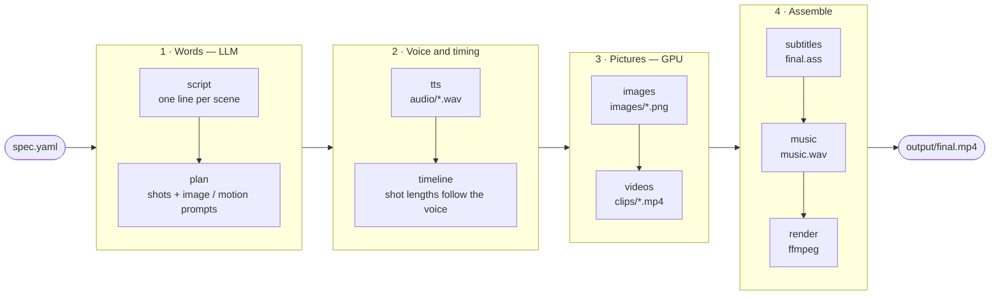

# anime-short-generator

Turns a topic or a `spec.yaml` into a finished vertical (9:16) anime Short: narration, burned-in
subtitles, optional background music, all the way to `final.mp4`. One Python package, one process,
a deterministic resumable pipeline (no agents) — FFmpeg handles media, a local GPU handles
image/video generation.

## Features

- **Two content formats** (`content.format`): `story` (a narrated plot with up to two recurring
  characters, built from a character bible) and `quotes` (a spoken monologue of short lines over
  scenery, one line per scene, no character bible).
- **Pluggable providers**, picked per-project in config, each behind the same small interface:
  - **LLM** (script + shot planning): any OpenAI-compatible chat endpoint with structured
    (JSON Schema) output — a local vLLM server by default, or a hosted model such as Gemini.
  - **TTS**: `vieneu` (local GPU), `elevenlabs` (hosted, word-level alignment), `gemini` (hosted,
    one-take reading split at the longest pauses).
  - **Image** (keyframes): `anima`, `netayume`, `zanime` (local GPU models) and `gemini` (hosted,
    supports a style reference image).
  - **Video**: `animegen` (Wan2.2-I2V on GPU, VRAM-gated) with automatic fallback to
    `still_motion` (a CPU cinemagraph effect animating the still keyframe) when VRAM is
    insufficient or generation OOMs.
  - **Music**: `library` (pick a free local track, trim silence, loudness-normalize) or `acestep`
    (generate an original track via an ACE-Step API).
- **Burned-in ASS subtitles**, word-timed when the TTS provider gives timestamps, otherwise
  chunked proportionally by character count; two visual styles (`shorts`: karaoke word
  highlighting; `quote`: whole-line fade-in).
- **Render effects**: film grain, vignette, an old-film "dust" overlay, two-pass loudness
  normalization, and music ducking under the voice.
- **VRAM-gated GPU stages**: every GPU-using stage measures free VRAM before loading a model
  (the GPU may be shared with other processes) and raises/falls back cleanly instead of risking
  an OOM crash mid-run.
- **Deterministic and resumable**: every generated artifact is seeded from stable ids, and the
  whole pipeline can be stopped and resumed — already-done work is skipped automatically.

## The 20% that explains 80% of it

- **`project.json` is the single source of truth.** Every stage reads the whole project state,
  does its work, writes the whole state back (atomically). There's no database, no per-stage
  files to reconcile — see [docs/architecture.md](docs/architecture.md). A per-project file lock
  stops two `anime-short` commands from running against the same project at once.
- **Scene vs. shot.** A *scene* is one narration/audio segment; a *shot* is one visual. A scene
  has 1-n shots, split so no single shot exceeds a configured max length. TTS is never re-run to
  fix pacing — long scenes just get more shots.
- **Stages are a fixed pipeline, run in order, each individually skippable/resumable**
  (`script -> plan -> tts -> timeline -> images -> videos -> subtitles -> music -> render`).
  Re-running an earlier stage marks every later stage pending again, but each stage's own
  per-item skip logic keeps that cheap when nothing actually changed.



Every stage reads `project.json`, adds its result, and writes it back.

For the algorithms running *inside* each stage (shot planning, TTS pause-splitting, deterministic
seeds, music/render ffmpeg chains, the dust overlay, subtitle chunking), see
[docs/algorithms.md](docs/algorithms.md).

## Quickstart

```bash
# install (uv; add the `gpu` extra for the local image/video/TTS models)
uv sync --extra gpu

# configure secrets (copy and fill in; never commit this file)
cp .env.example .env
# keys used, by name:
#   ELEVENLABS_API_KEY   - only if voice.provider: elevenlabs
#   LLM_API_KEY          - the script/plan LLM endpoint (default: local vLLM, "EMPTY")
#   GEMINI_API_KEY       - only if any provider is set to gemini (tts/image/llm)
#   ANIME_SHORT_FFMPEG / ANIME_SHORT_FFPROBE  - path to an ffmpeg/ffprobe build with libx264 + libass

# generate a whole project from a spec file, end to end
uv run anime-short generate examples/quotes_love_life.yaml

# ...or from a bare topic
uv run anime-short generate --topic "a quiet morning in Hoi An" --duration 45

# resume a project (runs every stage/item not already done)
uv run anime-short resume quotes_love_life

# run a single stage (e.g. after editing project.json by hand, or to force a redo)
uv run anime-short images quotes_love_life --force

# inspect progress
uv run anime-short status quotes_love_life
```

Each project lives at `workspace/<project_id>/` (gitignored): `project.json` plus every
intermediate artifact, ending in `output/final.mp4`.

## Folder structure

```
.
├── src/anime_short/     the package (see docs/architecture.md for a module-by-module map)
├── configs/
│   ├── default.yaml     base config: providers, per-provider options, render/GPU settings
│   └── styles/          named visual style bibles (prompt text + optional reference image)
├── templates/           LLM prompt templates for the script/plan stages
├── examples/            example spec.yaml files (story and quotes formats)
├── assets/
│   ├── fonts/           subtitle fonts
│   └── music/           local tracks for the `library` music provider
├── docs/
│   ├── architecture.md  modules, provider pattern, project.json, stage invalidation, GPU gating
│   └── algorithms.md    the non-trivial algorithm inside each stage, one diagram each
├── tests/               pytest suite (GPU/network tests are marked and skipped by default)
├── scripts/             one-off utility scripts (e.g. image-provider benchmarking)
├── SPEC.md              the module contract: pipeline stages, data model, config surface
└── workspace/           (gitignored) one directory per generated project
```

## Further reading

- [docs/architecture.md](docs/architecture.md) — modules and responsibilities, the
  provider/plugin pattern, `project.json` as the single state file, stage skipping and
  invalidation, GPU/VRAM gating and fallback.
- [docs/algorithms.md](docs/algorithms.md) — the non-trivial algorithm behind each stage: shot
  planning/replanning, timeline assembly, Gemini's one-take-reading pause splitting, deterministic
  seeds, music pick/loudnorm/ducking, the AnimeGen prompt assembly, the dust overlay, subtitle
  generation.
- [SPEC.md](SPEC.md) — the authoritative module contract (pipeline stages, data model, config
  surface); if code and this README ever disagree, SPEC.md plus the code win.
