# Algorithms

The non-trivial algorithms in the pipeline, verified against the source in `src/anime_short/`.
Simple one-pass steps (e.g. "burn the ASS file with ffmpeg") are omitted; see
[architecture.md](architecture.md) for the stage list and data flow.

## Word-count-targeted script generation

`src/anime_short/script/generator.py` — `generate_script()`

The LLM is asked for a script of roughly `duration_seconds * words_per_second` words of
narration, but it routinely misses the target (too short, occasionally far over), which would
silently change the final video's length. A retry loop re-asks with the actual word count fed
back, and keeps whichever attempt landed closest to the target.

Constants: `MIN_LENGTH_RATIO = 0.85`, `MAX_LENGTH_RATIO = 1.2`, `LENGTH_ATTEMPTS = 3`.

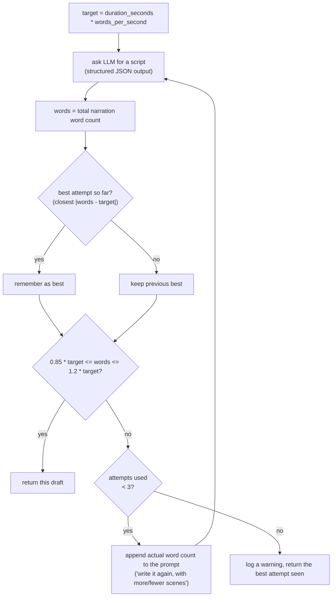

Each attempt itself goes through a nested, independent retry: `LLMClient.complete_structured()`
(`script/llm.py`) sends the request with `response_format={"type":"json_schema", "strict":true,
"additionalProperties":false}`; the configured LLM (vLLM qwen3-vl-8b locally, or a hosted model
like Gemini) is expected to constrain decoding to that schema, including `minItems`/`maxItems` on
arrays. If the JSON still fails to parse or fails Pydantic validation, the invalid response and
the error are appended to the conversation and resent, up to `llm.max_retries` times (default 3),
before raising `LLMError`. This retry is orthogonal to (nested inside) the word-count retry above.

## Shot planning and replanning

`src/anime_short/script/scene_planner.py`, `src/anime_short/pipeline/timeline.py`

Each scene is first split into a planned number of shots by the LLM (`plan_scene`), then the
`timeline` stage converts the scene's *actual* TTS audio duration into per-shot durations
(`plan_scene_shots`). If, after that split, any shot would exceed `max_shot_seconds`, the scene is
sent back to the LLM once more with the real duration and a hard per-shot length constraint
(`replan_scene`), and the split is recomputed.

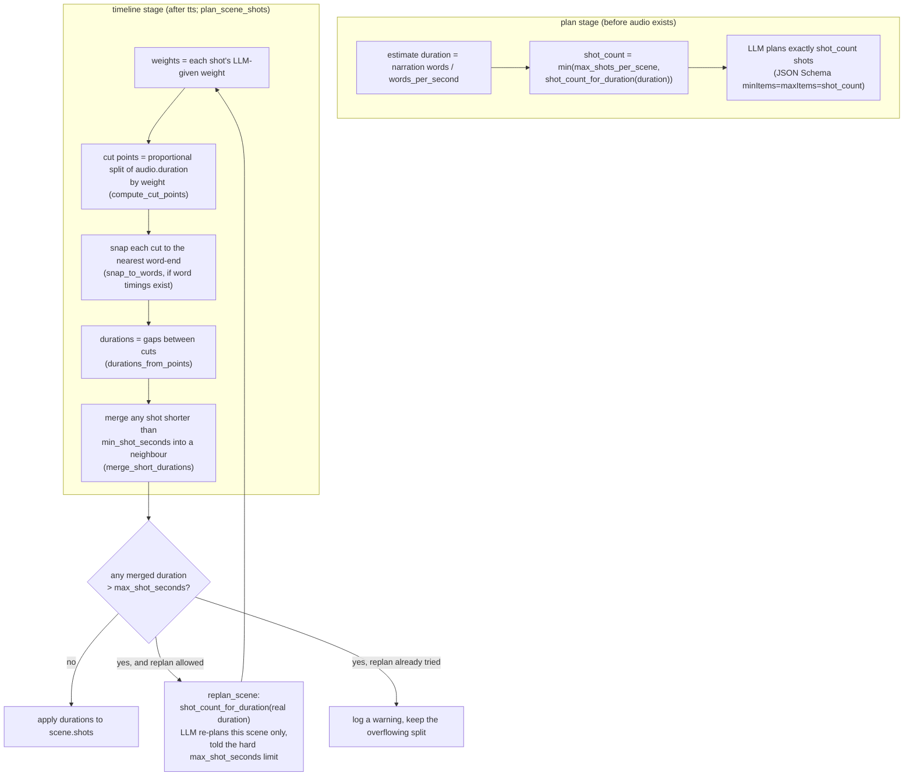

`shot_count_for_duration(duration, min_shot_seconds, max_shot_seconds)`: the smallest shot count
such that `duration / count <= max_shot_seconds`, without going under `min_shot_seconds` on
average — `count = ceil(duration / max_shot_seconds)`, then decremented while `count > 1 and
duration / count < min_shot_seconds`.

`merge_short_durations`: repeatedly finds the first shot shorter than `min_shot_seconds` and
merges it into the following shot (or the previous one, if it's the last shot), summing durations
and concatenating the original shot-index groups, until no shot is left short or only one remains.

A `static` camera move directly following another `static` shot is forced to a slow `push_in`
(`build_shots`), so the video is never fully frozen for two consecutive shots.

## Timeline assembly (absolute start times)

`src/anime_short/pipeline/timeline.py` — `run_timeline()`

Once every scene's shots have durations (from the algorithm above), a single left-to-right pass
assigns absolute `start` times: a running `cursor` is advanced by each scene's total duration plus
a fixed gap (`scene_gap_seconds`), with a longer `tail_seconds` added after the very last shot
instead of a gap.

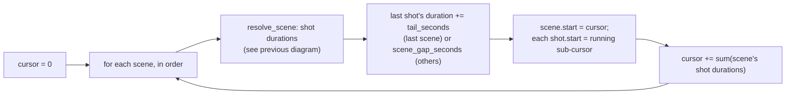

Stale-clear: if a shot's newly computed `duration` differs from what it was before this run, its
`shot.video` is reset to `None` so the next `videos` stage run regenerates that clip (the previous
clip's length no longer matches the timeline). This is one half of the stale-clear pattern; the
other half is in the `images` stage (new keyframe -> `shot.video = None` too). See
[architecture.md](architecture.md#stage-skipping-and-invalidation).

## Gemini TTS one-take reading, split at the longest pauses

`src/anime_short/tts/gemini.py`

Gemini TTS has no per-line API and no word timestamps, so the whole script is sent as **one**
request (all scene narrations joined by `"\n\n"`), read in a single take. The returned audio is
then split back into one file per scene by locating the longest pauses, with a self-check that
each line actually got a plausible share of the audio before accepting the split.

Constants: `FRAME_SECONDS = 0.01`, `SILENCE_DB = -40.0`, `MAX_SHARE_RATIO = 2.5`.

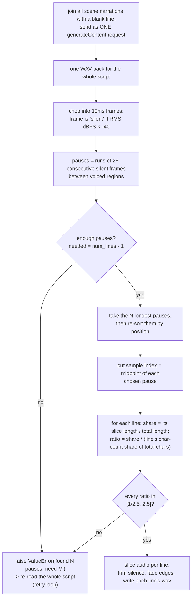

This whole-take approach also drives `tts/stage.py`'s skip logic: if the TTS provider exposes
`synthesize_script` (Gemini and ElevenLabs both do), then **any** scene being pending forces
*every* scene to be re-read, because a one-take reading cannot regenerate a single line in
isolation — `run_tts()` overwrites the per-scene pending list with every scene whenever
`whole_script` is true.

ElevenLabs' equivalent (`tts/elevenlabs.py`) is simpler because it gets real character-level
alignment back from the API: line boundaries are known text offsets (not detected pauses), and
each line's cut point is the time midpoint between the previous line's last aligned character and
the next line's first one.

## Deterministic seeds

Two independent seeding schemes exist, serving different purposes:

- **Stable, re-derivable seed** (`image/stage.py: deterministic_seed(project_id, shot_id)`):
  `int(sha256(f"{project_id}:{shot_id}")[:8 hex chars], 16)`. Used for image generation (unless a
  shot already has an explicit `seed`) and reused by the music stage
  (`deterministic_seed(project_id, "music")`) both for picking a library track
  (`random.Random(seed).choice(tracks)`) and as the ACE-Step generation seed — the same project id
  always yields the same image seeds and the same music choice, independent of run order or
  machine.
- **Per-output-path seed** (`video/animegen.py`, `video/still_motion.py`):
  `zlib.crc32(str(output_path).encode()) & 0xFFFFFFFF`. Used for the video-generation RNG (and,
  in `still_motion`, as the base `SeedSequence` for per-frame grain). This is intentionally
  independent from the image seed scheme — it seeds a different random process (motion/grain),
  keyed off the clip's own output file path rather than the project/shot id pair.

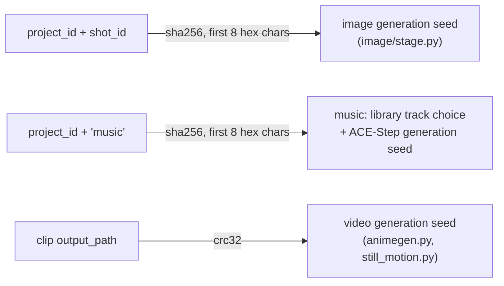

## Music: library pick, silence trim, two-pass loudnorm; looping/ducking/fade in render

### `music.provider: library` (`music/stage.py: pick_from_library`)

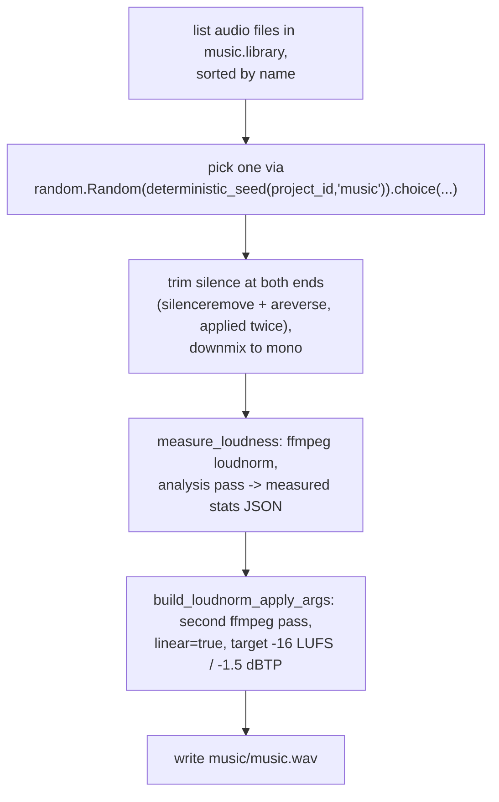

This two-pass loudnorm levels tracks pulled from many different sources (which can differ by
20+ dB) to the same loudness ACE-Step's own output roughly sits at, so `music.volume_db` means the
same thing regardless of which track (or provider) was used. It measures the mono downmix, since
the render mixes in mono and a wide stereo track loses up to ~8 dB there (a narrow one ~3 dB).

`music.provider: acestep` instead calls the ACE-Step REST API (`/release_task` then polling
`/query_result` until `status == 1`) for `duration = total video length + 8s extra` (generated
tracks tend to end abruptly, so there is slack for the render's own trim/fade), seeded with the
same `deterministic_seed(project_id, "music")`.

### Render: looping, ducking, fade (`render/ffmpeg.py: build_music_duck_args`)

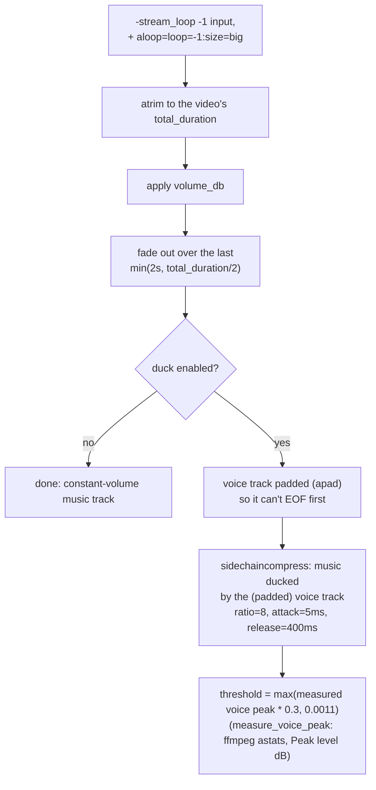

The final mix (`render/audio.py: build_final_audio`) is voice (all scene WAVs `adelay`'d to their
absolute start and `amix`'d together) mixed with the ducked/constant music track, then put through
the same two-pass loudnorm as the music-library step, targeting `render.loudness_lufs` (`-14`) and
`render.true_peak_db` (`-1`).

## AnimeGen (Wan2.2 I2V) prompt assembly

`src/anime_short/video/animegen.py: generate()`

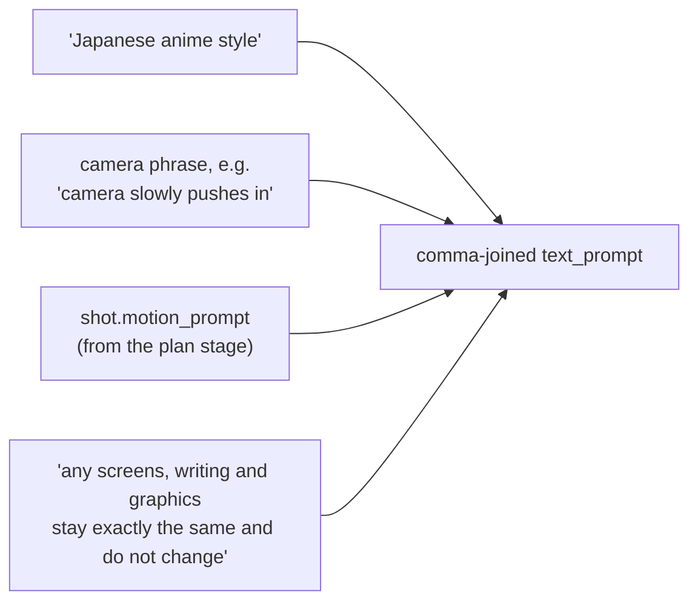

The camera phrase comes from a fixed lookup table (`_CAMERA_PHRASE`), one entry per `CameraMove`
enum value. The trailing "stable content" clause exists because, with `cfg=1.0` (CFG effectively
ignoring the negative prompt), the model otherwise invents gibberish text/graphics on any
screen-like surface the motion prompt asks to animate. A fixed `NEGATIVE_PROMPT = "3d, cg, photo,
stop, wait"` is still sent (for configurations where cfg isn't 1.0). Frame count is
`4*n+1` (Wan's required format) capped at `max_frames`, computed from the requested shot duration
and `native_fps`; resolution is snapped to the pipeline's `mod_value` while preserving the source
keyframe's aspect ratio, within the configured max pixel area.

Shots whose visual description implies a close-up/foreground screen, or that have explicit
on-screen `text`, are routed to `still_motion` instead even when AnimeGen is otherwise used
(`video/stage.py: _keeps_keyframe`) — see
[architecture.md](architecture.md#gpuvram-gating-and-fallback).

### `still_motion` cinemagraph fallback

`src/anime_short/video/still_motion.py`

A single keyframe is animated with a smooth sub-pixel camera move (no "Ken Burns judder") plus a
small secondary "breathing"/drift motion:

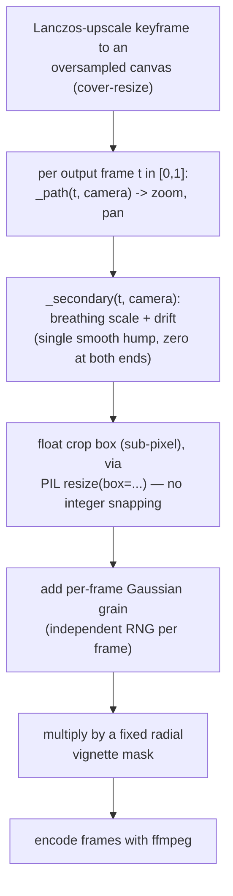

The primary move (`_path`) depends on the shot's `CameraMove`: `push_in`/`pull_out` sweep zoom
only; `pan_*`/`tilt_*` hold a fixed zoom and sweep the pan/tilt offset; `static` still gets a very
slow push-in so nothing is ever perfectly frozen. Both the primary ease (`_ease_in_out`, a
smoothstep) and the secondary hump (`sin(pi * t) ** 2`) have zero velocity at both endpoints, so
they never introduce a visible "kick" where they're added together.

## Old-film dust overlay

`src/anime_short/render/dust.py`, `src/anime_short/render/ffmpeg.py`

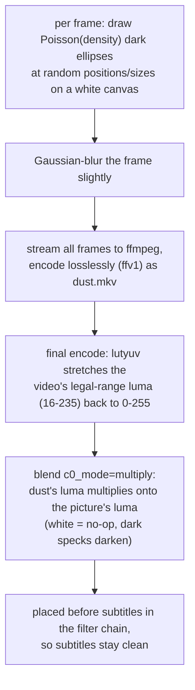

Each speck's radius is mostly small (1.5-4px at 1080p width, 75% of the time) with occasional
larger specks (4-10px), darkness drawn uniformly from a fixed range, and the whole frame blurred —
new independent specks every frame (no persistence), matching "dust & scratches"-style overlays.
Rendered once per render at the project's own resolution/fps/duration and seeded, so repeated
renders of the same project are reproducible.

## Subtitle generation

`src/anime_short/subtitle/{ass.py,chunks.py}`

Two independent ASS styles, chosen by `subtitle.style`:

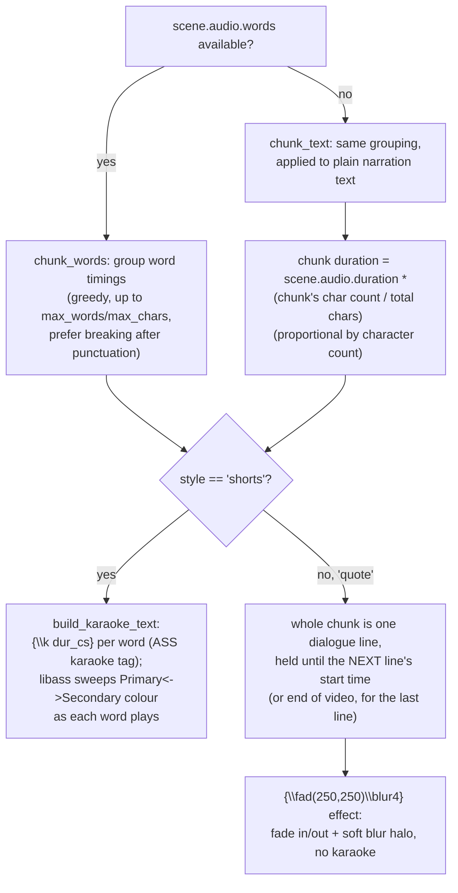

Both styles position every line via `\pos` + `\an5` (middle-center anchor) rather than ASS's
default bottom-alignment, with sizes/margins scaled by `project.height / 1920` so output
resolution doesn't change the relative text size. The "shorts" style uses `wrap_style=2` (exact
newlines, no auto-wrap) and bold text; the "quote" style uses `wrap_style=0` (libass
auto-balances wrapped lines) and italic text. `chunk_text`/`chunk_words` share one grouping
algorithm (`_group_indices`): tokens are added to the current group until the next one would
exceed `max_words` or `max_chars`, at which point the group is cut at the last punctuation
mark (`.,!?;:…`) inside it if one exists, otherwise at the limit itself.
