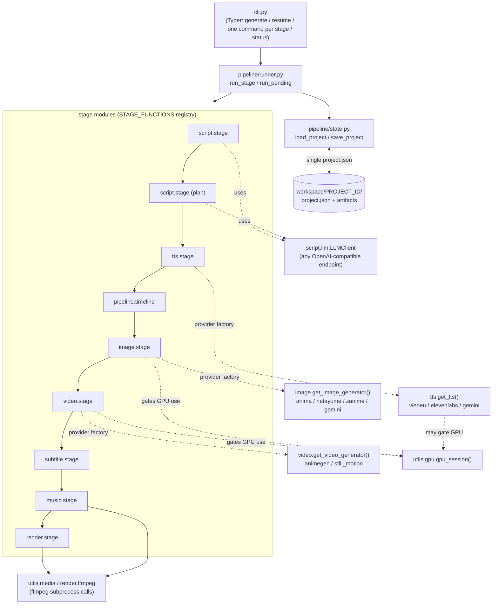
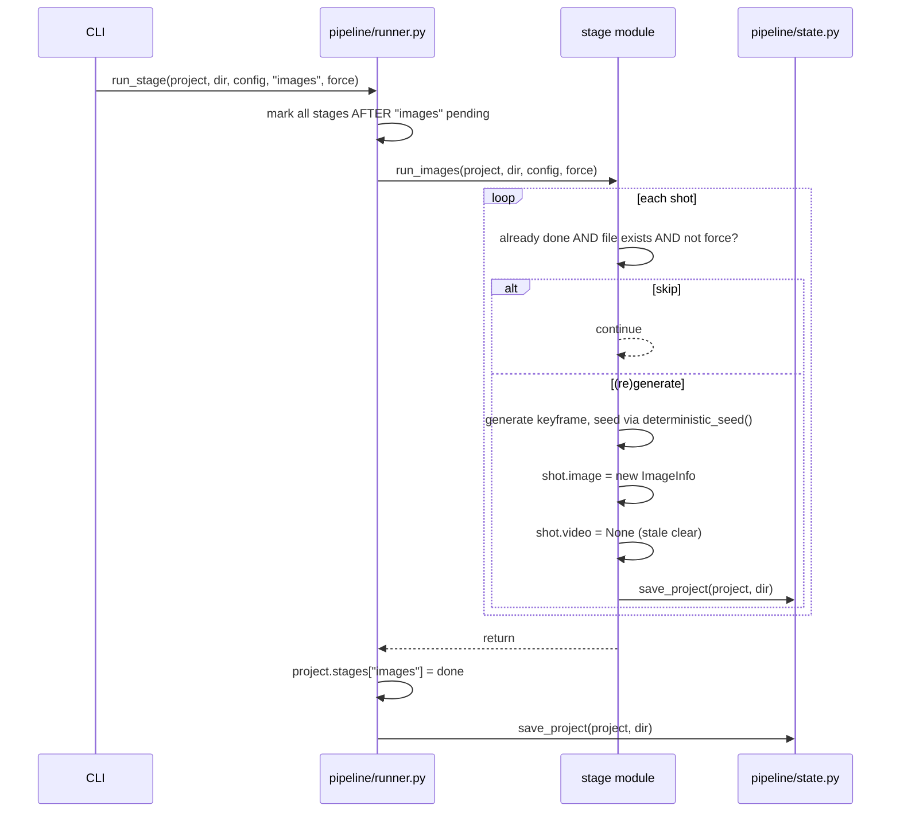
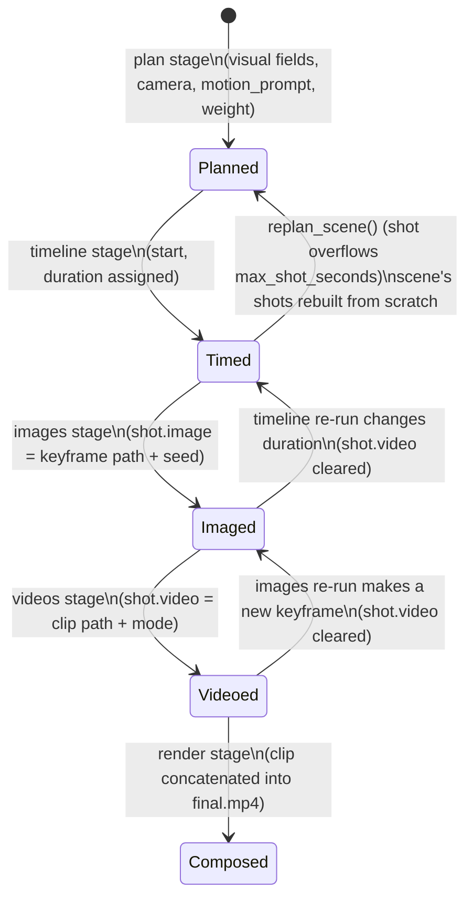
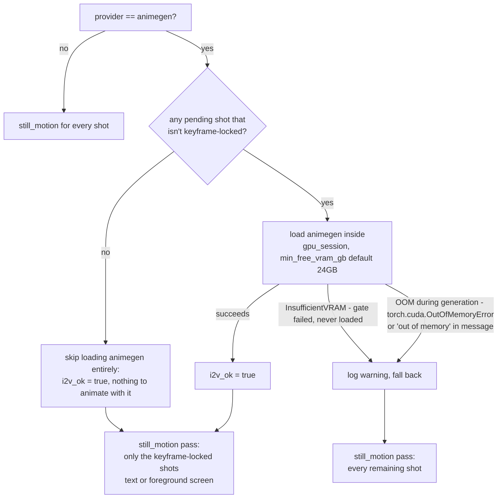

# Architecture

How the pipeline is put together: modules, the provider/plugin pattern, the single state file,
stage skipping/invalidation, and GPU/VRAM gating. For the algorithms that run *inside* individual
stages, see [algorithms.md](algorithms.md).

## Modules and responsibilities

```
src/anime_short/
├── cli.py                 Typer CLI: generate, resume, one command per stage, status
├── config.py              AppConfig (Pydantic): configs/default.yaml + spec.yaml overrides
├── schemas.py             ProjectSpec data model; STAGES tuple; project.json's shape
├── pipeline/
│   ├── runner.py          spec.yaml -> ProjectSpec; run_stage/run_pending orchestration
│   ├── state.py           load_project/save_project (atomic write), init_project_dir
│   └── timeline.py        timeline stage: shot durations + absolute start times
├── script/
│   ├── stage.py           script + plan stage entry points, replan_scene
│   ├── generator.py       script stage: topic -> scenes (word-count-targeted retry)
│   ├── scene_planner.py   plan stage: scene -> shots (structured LLM output)
│   ├── llm.py             structured-output chat client (any OpenAI-compatible endpoint)
│   └── prompts.py         prompt templates for script/plan calls
├── tts/
│   ├── stage.py           tts stage entry point, per-scene skip + whole-script override
│   ├── gemini.py          TTS provider
│   ├── elevenlabs.py      TTS provider
│   ├── vieneu.py          TTS provider
│   └── __init__.py        get_tts() factory (lazy imports)
├── image/
│   ├── stage.py           images stage entry point, deterministic_seed(), stale-clear
│   ├── prompt_builder.py  VisualSpec -> tags or natural-language prompt
│   ├── anima.py           image provider
│   ├── netayume.py        image provider
│   ├── zanime.py          image provider
│   ├── gemini.py          image provider
│   └── __init__.py        get_image_generator() factory (eager imports: torch always needed)
├── video/
│   ├── stage.py           videos stage: animegen with VRAM gate, still_motion fallback
│   ├── animegen.py        Wan2.2-I2V GPU provider
│   ├── still_motion.py    CPU cinemagraph fallback provider
│   └── postprocess.py     shared frame encoding/normalisation helpers
├── subtitle/
│   ├── stage.py           subtitles stage entry point (whole-stage skip)
│   ├── chunks.py          word/text grouping shared by both subtitle styles
│   └── ass.py             ASS document builder (shorts vs quote style)
├── music/
│   ├── stage.py           music stage: library pick or ACE-Step generation
│   └── acestep.py         ACE-Step REST API client
├── render/
│   ├── stage.py           render stage entry point (whole-stage skip)
│   ├── composer.py        orchestrates concat + audio + dust + final encode
│   ├── audio.py           voice mix, ducking, two-pass loudnorm
│   ├── ffmpeg.py          pure ffmpeg argument-list builders (no subprocess calls, mostly)
│   └── dust.py            old-film dust overlay generator
└── utils/
    ├── media.py           ffmpeg/ffprobe wrappers, binary resolution, probing
    └── gpu.py             VRAM gating (gpu_session, free_vram_gb, InsufficientVRAM)
```

Orchestration is intentionally "dumb": `pipeline/runner.py` just looks up a stage name in a
registry and calls it; all the actual logic (what to generate, what to skip, what to invalidate)
lives inside each stage module.

## Component diagram



## `project.json`: the single state file

`pipeline/state.py` defines the whole persistence layer in ~35 lines. A project's entire state —
scenes, shots, every artifact's path/seed/provider, and each stage's status — is one Pydantic
model (`ProjectSpec`, `schemas.py`) serialised to `workspace/<project_id>/project.json`. There is
no database and no per-stage state file.

Writes are atomic: `save_project()` writes the full JSON to a temp file in the same directory
(`tempfile.mkstemp`) and `os.replace()`s it over `project.json`, so a crash mid-write never leaves
a corrupt or partial file — the reader always sees either the old or the new complete state, never
a mix.

**This is also why stages must never run concurrently on the same project**: every stage function
reads the whole `ProjectSpec`, mutates part of it, and writes the whole thing back. Two stages (or
two runs of the same stage) running at once would each load a consistent snapshot, make their own
changes, and then one `save_project()` call would silently clobber the other's — there is no
merging or per-field compare-and-swap. `pipeline/runner.py` guards against this with a
project-level `filelock.FileLock` (`workspace/<project_id>/.lock`) held for the whole stage, or the
whole `run_pending` sequence: a second `anime-short <stage>`/`resume`/`generate` against the same
project fails fast with a clear error instead of racing.

All artifact paths stored in `project.json` are relative to the project directory, so the
`workspace/` tree (gitignored) can be moved or renamed without editing the file.

## Stage skipping and invalidation ("stale clears")

Two skip granularities coexist:

- **Whole-stage skip**: stages like `timeline`, `subtitles`, `render` just check
  `project.stages[stage] == "done"` and return immediately unless `--force` is passed (there's one
  artifact, or one pass, for the whole stage).
- **Per-item skip**: stages like `tts`, `images`, `videos` loop over scenes/shots and skip only the
  ones that are both recorded as done in `project.json` *and* whose artifact file still exists on
  disk (a missing file — e.g. from a crash right after marking done but before the file landed, or
  a deleted `workspace/` subtree — forces regeneration of just that item, not the whole stage).

Because downstream stages consume upstream artifacts, regenerating an upstream one can make a
downstream one stale. Two mechanisms keep this consistent without a dependency graph:

1. **`run_stage()` marks every later stage pending** before running the current one
   (`pipeline/runner.py`): any stage you explicitly re-run might change its output, so every stage
   after it is re-checked on the next `resume`/`generate` (their own per-item skips keep this
   cheap when nothing actually changed).
2. **Explicit "stale clears"** at the two points where a per-item change can invalidate a specific
   downstream artifact without finishing the whole stage:
   - `image.stage.run_images()`: generating a new keyframe sets `shot.video = None` (the old clip
     was animated from the keyframe that no longer exists).
   - `pipeline.timeline.run_timeline()`: if a shot's newly computed duration differs from its
     previous one, `shot.video = None` (the old clip's length no longer matches the timeline).



## State of one shot through the stages



## Provider/plugin pattern

Every pluggable capability (TTS, image generation, video generation) is a small `Protocol`
(`tts/base.py`, `image/base.py`, `video/base.py`): a `name` attribute plus `load()` / `unload()` /
`generate(...)`. A factory function per capability picks the concrete implementation from config
(`image.provider`, `video.provider`, `voice.provider`), so stage code never imports a specific
provider directly — it only calls the Protocol's methods.

- **Image** (`image/__init__.py`): imports are **eager** — a dict of provider name to a function
  that imports and builds that provider — because image generation always needs `torch` on this
  machine (there's no CPU-only image path), so there's no benefit to deferring the import.
- **Video** and **TTS** (`video/__init__.py`, `tts/__init__.py`): imports are **lazy** (done
  inside the factory function, only for the requested provider), specifically so commands that
  don't need GPU libraries (e.g. `anime-short status`, or running only the `script`/`plan` stages)
  never import `torch`/`diffusers`/etc. at all.

Providers that call a hosted API (Gemini TTS/image, ElevenLabs, ACE-Step) and providers that run a
local model (`vieneu`, `anima`, `netayume`, `zanime`, `animegen`) implement the exact same
Protocol; network providers' `load()`/`unload()` are typically no-ops (or just open/close an HTTP
client), while local-model providers' `load()` actually puts weights on the GPU.

## GPU/VRAM gating and fallback

The GPU is explicitly shared with other services on the machine (`utils/gpu.py`'s module
docstring: "never assume it is free"). `gpu_session(model, min_free_gb)` is a context manager that:

1. Checks `free_vram_gb()` (via `torch.cuda.mem_get_info`) against `min_free_gb` **before** calling
   `model.load()`, raising `InsufficientVRAM` if there isn't enough headroom — so a model is never
   half-loaded into a GPU that can't actually fit it.
2. Calls `model.load()`, yields the model.
3. In a `finally` block, always calls `model.unload()` then `release_cuda_memory()`
   (`gc.collect()` + `torch.cuda.empty_cache()`), so a failure during generation still frees VRAM
   for whatever runs next.

`video/stage.py` layers a specific fallback policy on top of this for the `videos` stage, since it
is the heaviest GPU consumer (Wan2.2-I2V via `animegen`):



"Keyframe-locked" shots (`_keeps_keyframe`, `video/stage.py`) are shots whose visual description
has on-screen `text`, or mentions a "screen" in a close-up/foreground framing — i2v has been
observed to rewrite such screens/text into gibberish even when told not to, so those shots always
go through the keyframe-preserving `still_motion` generator regardless of which provider is
configured. This means even a fully successful `animegen` run still invokes `still_motion` for
that subset of shots.

Other GPU-gated stages (`images`, and `vieneu` TTS) use the same `gpu_session()` helper directly,
without an animegen-style fallback chain, since there is no CPU alternative generator configured
for those (a VRAM-gate failure there simply raises and stops the stage).
