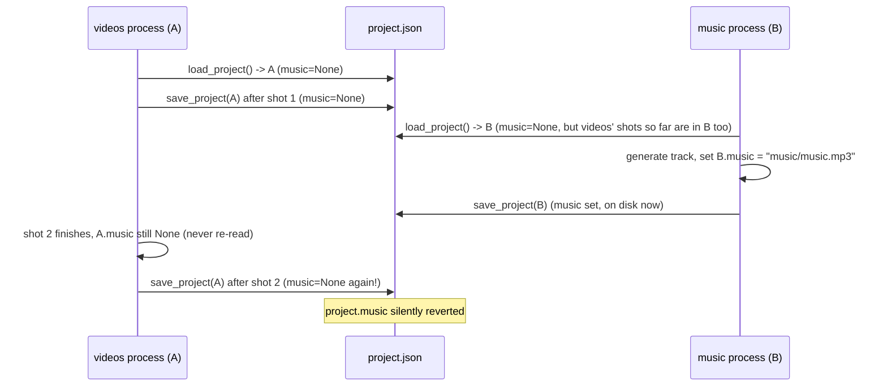

# Improvement plan — 2026-10-03

Scope: engineering review of the pipeline's orchestration, concurrency and system-design
properties. Every claim below cites the file and line it is based on. This is a read-only review:
no code changed, no stage was run, nothing in `workspace/` was touched.

## 1. Current state (thực trạng)

### 1.1 How a stage actually runs

The CLI (`src/anime_short/cli.py`) is a thin Typer wrapper. Each of the nine stages gets its own
subcommand generated in a loop:

```20:34:src/anime_short/cli.py
def _stage_command(stage: str) -> None:
    def command(project_id: ProjectId, force: Force = False) -> None:
        project_dir = _project_dir(project_id)
        config = runner.project_config(project_dir)
        runner.run_stage(load_project(project_dir), project_dir, config, stage, force)
```
(`src/anime_short/cli.py:71-78`)

`generate` and `resume` instead call `runner.run_pending`, which loads the project **once** and
loops over `STAGES` in-process:

```158:166:src/anime_short/pipeline/runner.py
def run_pending(project_dir: Path, force: bool = False) -> ProjectSpec:
    """Run every stage not marked done, in order (used by `generate` and `resume`)."""
    config = project_config(project_dir)
    project = load_project(project_dir)
    for stage in STAGES:
        if force or project.stages.get(stage) != StageStatus.done:
            run_stage(project, project_dir, config, stage, force)
    return project
```
(`src/anime_short/pipeline/runner.py:158-165`)

Everything is synchronous, single-process, single-thread: one Python interpreter walks
`STAGES = ("script", "plan", "tts", "timeline", "images", "videos", "subtitles", "music",
"render")` (`src/anime_short/schemas.py:21-31`) in order. There is no scheduler, no background
workers, no async runtime anywhere in `src/anime_short/`.

`run_stage` is the only place that mutates `project.stages` for the stage as a whole:

```138:155:src/anime_short/pipeline/runner.py
def run_stage(
    project: ProjectSpec, project_dir: Path, config: AppConfig, stage: str, force: bool = False
) -> None:
    log.info("stage %s: start", stage)
    for later in STAGES[STAGES.index(stage) + 1 :]:
        project.stages[later] = StageStatus.pending
    try:
        stage_function(stage)(project, project_dir, config, force)
    except BaseException:
        project.stages[stage] = StageStatus.failed
        save_project(project, project_dir)
        log.exception("stage %s: failed", stage)
        raise
    project.stages[stage] = StageStatus.done
    save_project(project, project_dir)
```
(`src/anime_short/pipeline/runner.py:138-155`)

Each stage function additionally saves after every item it processes (that is the resumability
mechanism, SPEC §3): e.g. the TTS stage saves after each scene
(`src/anime_short/tts/stage.py:54`), images after each shot (`src/anime_short/image/stage.py:79`),
videos after each shot (`src/anime_short/video/stage.py:80`), plan after each scene
(`src/anime_short/script/stage.py:75`), music once after the track is written
(`src/anime_short/music/stage.py:51,62`).

### 1.2 Where `project.json` is loaded and saved

`src/anime_short/pipeline/state.py` is the entire persistence layer:

```15:34:src/anime_short/pipeline/state.py
def load_project(project_dir: Path) -> ProjectSpec:
    return ProjectSpec.model_validate_json((project_dir / PROJECT_FILE).read_text(encoding="utf-8"))


def save_project(project: ProjectSpec, project_dir: Path) -> None:
    project_dir.mkdir(parents=True, exist_ok=True)
    data = project.model_dump_json(indent=2)
    fd, tmp = tempfile.mkstemp(dir=project_dir, prefix=".project.", suffix=".json")
    try:
        with os.fdopen(fd, "w", encoding="utf-8") as f:
            f.write(data)
        os.replace(tmp, project_dir / PROJECT_FILE)
    except BaseException:
        Path(tmp).unlink(missing_ok=True)
        raise
```
(`src/anime_short/pipeline/state.py:20-34`)

`save_project` is atomic **as a single write**: temp file + `os.replace` means a reader never sees
a half-written `project.json`, and a crash mid-write never corrupts it. SPEC.md explicitly calls
this out as the contract: "saves it after **each item** (atomic write: temp file + rename)"
(`SPEC.md:61`). That half of the contract is correctly implemented.

What it does **not** protect against is two *processes* holding two different in-memory copies of
the whole `ProjectSpec` and each calling `save_project` with its own copy. `ProjectSpec` is loaded
once per process — at the top of `_stage_command` (`cli.py:74`, via `load_project`) or once in
`run_pending` (`runner.py:161`) — and kept in memory for the rest of that process's run. Every
`save_project` call serialises the *entire* object (`model_dump_json`, not a patch), so a save from
process B always overwrites whatever process A wrote to disk after B's last read, including fields
B never touched.

### 1.3 The known race: `project.music` got reverted

This is reproducible from the code, not hypothetical:

1. `anime-short videos <project>` starts. `_project_dir`/`load_project` reads `project.json` into
   an in-memory `ProjectSpec` A (`project.music is None`, music stage not run yet).
2. The videos stage is long (GPU model load + per-shot generation); it calls
   `save_project(A, project_dir)` after **every shot** (`src/anime_short/video/stage.py:80`), each
   time writing the complete object A — including `A.music = None` — back to `project.json`.
3. While videos is still running, `anime-short music <project>` is started in a second terminal.
   It calls `load_project` independently, getting a fresh `ProjectSpec` B that *does* reflect disk
   state at that moment. It runs to completion quickly (no GPU, just ffmpeg + maybe an ACE-Step
   HTTP call), sets `B.music = MUSIC_FILE` and saves (`src/anime_short/music/stage.py:61-62`).
   `project.json` on disk now has `music` set.
4. The videos process (still running, still holding stale in-memory A with `music=None`) finishes
   its next shot and calls `save_project(A, project_dir)` again
   (`src/anime_short/video/stage.py:80`). This overwrites `project.json` with A's snapshot, which
   has no knowledge the music stage ever ran — `project.music` reverts to `None` even though
   `music/music.mp3` still exists on disk.

Root cause in one sentence: **every stage treats `ProjectSpec` as a whole-document, read-once /
write-many, last-writer-wins value, so two processes running concurrently always lose whichever
update was made to the "other" process's part of the document.** This is a lost-update problem,
not a torn-write problem — `os.replace` already solved torn writes; it cannot solve lost updates
because the conflict is between two full in-memory copies, not between two concurrent writers of
the same bytes.



Nothing in `run_stage`, `save_project`, or any stage module re-reads `project.json` before saving;
there is no version check, no file lock, and no merge. This matches the task's description of what
"actually happened."

## 2. Threads, async/await, parallelism and concurrency

### 2.1 Where the time actually goes

| Kind | Call sites | Blocking primitive |
|---|---|---|
| LLM call per scene (script, plan, replan) | `src/anime_short/script/llm.py:81` (`OpenAI().chat.completions.create`, sync SDK) | network round trip, local vLLM at `http://localhost:8093/v1` (`configs/default.yaml:4`) |
| TTS HTTP (ElevenLabs, Gemini) | `src/anime_short/tts/elevenlabs.py:151` (`httpx.Client.post`), Gemini TTS provider similarly | network |
| Image HTTP (Gemini image) | `src/anime_short/image/gemini.py:114` (`httpx.Client.post`) | network, ~25 s/img (SPEC §6) |
| ACE-Step music (HTTP + poll) | `src/anime_short/music/acestep.py:50,59,68` (`httpx.Client.post`/`.get`), polling loop at `_wait` (`acestep.py:56-65`) with `time.sleep(self.poll_seconds)` | network + server-side GPU, but the *client* side is pure I/O wait |
| ffmpeg subprocesses | `src/anime_short/utils/media.py:55-60` (`run_ffmpeg`, `subprocess.run`), used by render (`composer.py`), music trimming (`music/stage.py:79-83`), postprocess (`video/postprocess.py`) | subprocess, CPU-bound inside ffmpeg but the Python side just blocks waiting |
| Local GPU models (images, i2v, TTS) | `src/anime_short/image/{anima,netayume,zanime}.py`, `src/anime_short/video/animegen.py:69-191`, local `vieneu` TTS | GPU compute, serialized by design |

This is a clean split: everything in the top half of the table is **I/O-bound** (waiting on a
socket or a subprocess, not holding the GIL in CPU work); everything in the bottom half is
**GPU-bound** and intentionally serialized.

### 2.2 Why the GPU side should *not* get asyncio/threads

SPEC.md is explicit that stages are "batched (all images, then unload, then all videos) — never
interleave models on the GPU" (`SPEC.md:56`), and the code enforces this with a single
`gpu_session` context manager:

```46:62:src/anime_short/utils/gpu.py
@contextmanager
def gpu_session(model: Loadable, min_free_gb: float = 0.0) -> Iterator[Loadable]:
    free = free_vram_gb()
    if free < min_free_gb:
        raise InsufficientVRAM(...)
    model.load()
    try:
        yield model
    finally:
        model.unload()
        release_cuda_memory()
```
(`src/anime_short/utils/gpu.py:46-62`)

`video/stage.py` loads the `animegen` generator once, with a VRAM gate
(`config.video.animegen.get("min_free_vram_gb", 24)`, `video/stage.py:102`, default
`min_free_vram_gb: 24` in `configs/default.yaml:70`), runs every shot inside that one session
(`video/stage.py:104`), and only falls back to the CPU-only `still_motion` generator when
`InsufficientVRAM` or an OOM is caught (`video/stage.py:115-121`). The GPU itself is one physical
resource shared with other services (SPEC §1: an H100 with ~29 GB free out of 80 GB, "Never stop
or disturb other GPU processes"). Running two GPU jobs "in parallel" from this process would not
make them faster — CUDA kernels from two models on one device still serialize or thrash memory —
it would only risk two models being resident at once and blowing the shared VRAM budget the whole
design is built around. **Concurrency here would add risk (OOM, corrupting another team's vLLM
session) for no real speedup.** The current one-session-at-a-time design is correct and should not
change.

The planner's one-scene-per-call pattern is also not a concurrency problem to "fix" — it is a hard
constraint from the local model's context window. `run_plan` iterates scenes and calls `plan_scene`
once per scene (`src/anime_short/script/stage.py:63-75`); SPEC.md states why: "Keep context small
(8k model limit): plan one scene per call" (`SPEC.md:116`), and `scene_planner.py` builds the
`extra_constraints` string per call precisely because "each scene is planned in its own call"
(`src/anime_short/script/scene_planner.py:149`). Firing several of these calls concurrently against
the *local* vLLM server (`configs/default.yaml:4`, context 8192) would not help: it is one model on
one GPU serving one request queue — concurrent requests would just queue behind each other
server-side (and risk starving whatever else shares that vLLM instance), while adding complexity to
a part of the code (prompt sequencing, "tell the LLM the previous shot's camera",
`scene_planner.py:148-154`) that currently depends on scenes being planned in narration order. This
is explicitly *not* worth parallelizing.

### 2.3 Where asyncio/threads *would* help

The candidates are the pure-I/O-wait steps that do not touch the shared GPU and do not depend on
each other's *results* (only on being coordinated before the GPU stages that consume them):

- **TTS for multiple scenes against a remote HTTP provider** (ElevenLabs/Gemini) — but note
  `tts/stage.py` already prefers `synthesize_script` (one request for the whole script) whenever
  the provider exposes it (`tts/stage.py:37-46`), specifically so intonation carries across lines;
  concurrency only matters for the `synthesize` per-scene path, which is the fallback.
- **Gemini image generation for multiple shots** — each `httpx.Client.post` is independent, ~25 s
  each (SPEC §6), and there is no GPU session involved for this provider at all (`load`/`unload`
  are no-ops, `image/gemini.py:63-67`), so several requests in flight would shorten wall-clock time
  for Gemini-backed projects without touching local VRAM.
- **ffmpeg subprocess steps that do not depend on each other** — e.g. in the render stage,
  `concat_shots` and the dust-video generation (`composer.py:38-51`) do not need each other's
  output before `build_final_encode_args`; they are currently sequential simply because the code
  is written sequentially, not because of a real dependency.
- **ACE-Step polling** (`acestep.py:56-65`) blocks the whole music stage on `time.sleep`; this
  specifically wastes wall-clock time (not CPU), and is the kind of thing `asyncio.sleep` in an
  async client — or simply running it on a background thread while other I/O-bound work proceeds —
  would help with, if there were other I/O-bound work to overlap it with.

None of this is large: a 45–60 s short typically has a handful of scenes and shots, so the
absolute time saved by parallelizing network calls is on the order of seconds to maybe one minute
per run, bounded by rate limits anyway. It is a legitimate, low-risk improvement, not a priority one.

### 2.4 asyncio vs threads vs process pools, concretely

- **asyncio** would require switching the `openai` client and `httpx.Client` call sites to their
  async counterparts (`AsyncOpenAI`, `httpx.AsyncClient`) and making every stage function async,
  which cascades into `runner.py`, `cli.py` (Typer commands would need `asyncio.run`), and every
  test that calls a stage function directly. That is a wide, invasive refactor for a narrow,
  bounded win (see 2.3).
- **A thread pool** (`concurrent.futures.ThreadPoolExecutor`) around just the I/O-bound leaf calls
  (e.g. `ElevenLabsProvider._request`, `GeminiGenerator._request`, `run_ffmpeg`) is far cheaper:
  these functions already return simple results and don't share mutable state beyond what the
  caller does with the return value. This is the pragmatic option if/when the per-shot Gemini image
  or ElevenLabs-per-scene case is actually the bottleneck in practice.
- **A process pool** has no clear use here: nothing CPU-bound in Python itself needs it (ffmpeg and
  the GPU models are already separate OS processes/CUDA contexts; `subprocess.run` already gives up
  the GIL while ffmpeg runs).

### 2.5 Rate limits and retries

Both HTTP providers already implement bounded retry-with-backoff for retryable status codes:

```148:175:src/anime_short/tts/elevenlabs.py
RETRYABLE_STATUS_CODES = {429, 500, 502, 503, 504}
...
for attempt in range(self._max_retries + 1):
    ...
    if attempt < self._max_retries:
        delay = self._retry_backoff * (2**attempt)
        ...
        time.sleep(delay)
```
(`src/anime_short/tts/elevenlabs.py:28,148-175`; the Gemini image provider has the identical
pattern at `src/anime_short/image/gemini.py:30,109-130`). The LLM client instead retries on
*schema-invalid* responses, not transport errors (`script/llm.py:79-109`) — the `openai` SDK itself
already retries transport-level failures by default. `AceStepClient` has no retry at all around its
`_post` calls (`music/acestep.py:67-70`): a transient failure during `/release_task` or
`/query_result` raises immediately and kills the music stage. This is a small, real gap (see
Proposals, P2) but low severity since ACE-Step is a local service, not a rate-limited public API.

All HTTP clients are `httpx.Client` (sync), matching the fully-synchronous pipeline; there is no
`httpx.AsyncClient` usage anywhere in the codebase today.

## 3. Concurrency safety of state

Options, evaluated against this codebase specifically:

| Option | What it buys | Cost / downside here |
|---|---|---|
| **Per-stage file locking** (e.g. `filelock`, flock on `project.json`) | Serializes concurrent *writers*; stops the lost-update race described in §1.3 | Doesn't by itself fix the stale-in-memory-copy problem: a lock around `save_project` alone would still let process A overwrite B's change, just not mid-write. Needs to be paired with a re-read-before-write or a merge step. |
| **Atomic writes (temp file + rename)** | Already implemented (`state.py:24-34`) | Solves torn writes only; does nothing for lost updates. Keep it, it's correct. |
| **Save only the changed sub-tree / merge-on-save** | Each stage's save only touches the fields it actually changed (e.g. `scene.audio`, `shot.image`, `project.music`), so two processes' writes compose instead of clobbering | Requires `save_project` to know which part of the document a given stage is allowed to own, or a generic JSON-merge-patch; more code than a lock, and still has to handle "the same field changed on both sides" (rare, but needs a defined rule — e.g. last-write-wins at the field level, which is still sketchy if a field was deleted). |
| **Project-level lock** (one process at a time may run *any* stage against a given project) | Simplest possible fix; turns "two stages run concurrently" into "the second one waits (or fails fast)" | This is almost free given the existing architecture: stages are already meant to run one-at-a-time per project (SPEC's own mental model is a sequential pipeline); a lock just makes that assumption true instead of merely assumed. |
| **Optimistic versioning** (store a version/hash in `project.json`, `save_project` refuses to overwrite if the on-disk version moved since `load_project`) | Correct in the general distributed-systems sense; never silently loses data | Still requires the caller to handle "someone else changed it" (retry by re-reading and re-applying the stage's own in-memory delta — which again needs a merge model, same complexity as the sub-tree option, but now with a failure path to design and test). |

### Recommendation

Add a **project-level lock**: before any stage function runs, acquire an exclusive lock on a
sentinel file in the project directory (e.g. `project_dir / ".lock"`, via `filelock.FileLock` or
`fcntl.flock`), held for the duration of the stage (not just the final save), and release it when
the stage returns or raises. This directly prevents the §1.3 scenario (two `anime-short <stage>`
invocations for the same project id running at once) with:

- **Minimal code**: one context manager wrapped around the body of `run_stage`
  (`src/anime_short/pipeline/runner.py:138-155`), no change to `ProjectSpec`, `save_project`, or
  any individual stage module.
- **No new failure modes to design**: a second process either blocks until the first finishes, or
  (preferable for this CLI tool) fails immediately with "project X is already running (stage Y)" —
  simpler to reason about than merge semantics, and matches how the user actually invokes stages
  (one terminal command at a time, occasionally two by mistake).
  - **Robustness**: it cannot silently lose data the way the current code does; the worst case is a
  clear error message telling the user to wait or kill the other process.

This is deliberately the *simple* fix. Merge-on-save or optimistic versioning are more "correct" in
a world where legitimately-concurrent stage runs are a normal thing to want (e.g. a future web UI
queuing independent stages), but nothing in this codebase's design intends stages to run
concurrently against the *same* project — SPEC.md's own pipeline diagram is a strict sequence
(`SPEC.md:28-51`). A lock encodes the actual intended usage; a merge model would be solving a
problem the architecture doesn't otherwise have.

## 4. System design

### 4.1 Stage DAG and staleness tracking

The current "DAG" is really a fixed total order, `STAGES` (`schemas.py:21-31`), walked linearly.
Staleness is tracked coarsely: running any stage marks **every later stage** pending
(`runner.py:144-145`), regardless of whether that stage actually invalidated anything downstream.
Within a stage, item-level staleness is ad hoc per module — e.g. images checks
`shot.image is not None and (project_dir / shot.image.path).exists()` (`image/stage.py:49`), videos
checks `shot.video is not None and (project_dir / shot.video.path).exists()`
(`video/stage.py:35`), and the images stage explicitly resets `shot.video = None` when it
regenerates a keyframe (`image/stage.py:78`) so videos knows to redo that shot. This works, but
each stage reimplements its own "is my output still valid" check against the filesystem; there is
no single staleness primitive.


A real DAG only matters if some stage can be skipped independent of its neighbours (e.g. re-running
`images` with a different style should not force `tts` to re-run, which is already true) — that
part already works via the per-item checks. What the DAG doesn't model is *why* a later stage
reruns: today it's "the file is missing" or "blanket invalidate everything after me," never "this
specific upstream fact changed so only this downstream fact needs to change."

### 4.2 Caching and content hashing

There is no content hashing. `ImageInfo`/`VideoInfo`/`AudioInfo` do not store a hash of the prompt,
seed, or config that produced them (`schemas.py:94-126`); "is this still valid" is purely
"does the file referenced by the stored path exist." Two consequences visible in the code:

- Changing `configs/default.yaml` (e.g. image steps/CFG) after images already exist does not
  retrigger regeneration — the stage only checks `shot.image is not None and ... .exists()`
  (`image/stage.py:49`), with no comparison of the config that produced it.
  `--force` is the only lever, and it is all-or-nothing per stage.
  - Seeds are deterministic (`deterministic_seed`, `image/stage.py:19-22`, reused by music
  (`music/stage.py:12,58`)), so regeneration *would* be reproducible if forced — the gap is that
  the system can't tell you it's stale, only that it's missing.

### 4.3 GPU job queue

There isn't one, and for the reasons in §2.2 (one shared GPU, explicit "never interleave models")
that's appropriate for a single-machine CLI tool run by one person at a time. A queue becomes
worth having only if this pipeline is driven by more than one caller at once (e.g. a future web
service processing several users' projects) — then a queue is how you'd keep "one GPU model loaded
at a time" true *across* processes instead of relying on each process's own `gpu_session`. That is
a different product shape than what exists today; see §5 (P2 / not-now).

### 4.4 Observability / logging

Logging is `logging` + Rich (`utils/logging.py`), stage-level `log.info("stage %s: start/done")`
(`runner.py:141,151,155`) and per-item `log.info(...)` inside each stage (e.g.
`tts/stage.py:55-61`, `video/stage.py:68`). There is no structured logging (JSON lines, timing per
item), no metrics, and no run manifest beyond `project.json` itself. For a single-operator CLI this
is adequate; it would not be adequate if this were a service with multiple concurrent projects.

### 4.5 Error handling and fallbacks

The one real fallback in the system is videos: animegen → still_motion on `InsufficientVRAM` or an
OOM caught via `_is_oom` (`video/stage.py:20-28,115-121`); every other stage either succeeds or
raises, and `run_stage` records `StageStatus.failed` and re-raises (`runner.py:148-152`) so the CLI
exits non-zero and `resume` will retry that stage next time. This is simple and legible — there is
no silent partial success.

### 4.6 Config layering

`config.py` layers `configs/default.yaml` with per-project `spec.yaml` overrides via `deep_merge`
(`config.py:135-142,150-155`), and `spec_to_overrides` maps the user-facing `spec.yaml` shape onto
`AppConfig` keys (`runner.py:83-103`). Provider-specific sections (`image.providers`,
`video.animegen`, `music.acestep`, etc.) stay untyped `dict[str, Any]` (e.g. `ImageConfig.providers:
dict[str, dict[str, Any]]`, `config.py:63`) so each provider validates its own options — a
deliberate, reasonable choice given how many providers exist and how different their options are.

### 4.7 Provider interfaces

Every provider family is a `typing.Protocol` with a small, consistent surface:
`ImageGenerator` (`image/base.py:9-28`: `load/unload/generate`, plus `prompt_style` and
`supports_reference`), `VideoGenerator` (`video/base.py:9-24`: `load/unload/generate`), `TTSProvider`
(`tts/base.py:9-16`: `synthesize`, optionally `synthesize_script` via `hasattr` duck-typing,
`tts/stage.py:37`). Factories (`image/__init__.py:12-23`, similarly for video/tts) map a config
string to a class. This is a clean, minimal plugin boundary — exactly the kind of thing that should
not be made more "flexible" than it is.

### 4.8 Testing gaps

`tests/` covers schemas, config merge, the timeline math, prompt building, ASS generation, ffmpeg
command building, and — per `tests/test_runner.py` — the stage-skip/resume/failure-marking logic
(`test_run_pending_skips_done_and_marks_failure`, `test_running_a_stage_resets_later_stages`,
`tests/test_runner.py:86-144`). There is **no test exercising two concurrent `save_project` calls**
or two concurrent stage runs against the same project directory — consistent with §1.3 being a real
bug that unit tests would not have caught, since each test drives a single in-process call
sequence. GPU and network paths are correctly marked `@pytest.mark.gpu` / `@pytest.mark.network`
(SPEC §14) and skipped by default, so they're outside normal CI anyway.

## 5. Proposals

### P0 — do now

**P0.1 — Project-level lock around stage execution. [DONE 2026-10-03]**
- Problem: concurrent stage invocations silently lose data (§1.3); this already happened.
- Proposal: wrap `run_stage` (`pipeline/runner.py:138-155`) in a `FileLock(project_dir / ".lock")`
  (or `fcntl.flock`), acquired non-blocking with a clear error ("project is already running stage
  X; wait or check for a stuck process") rather than a silent indefinite wait, since a stuck lock
  file from a killed process is otherwise a foot-gun.
- Effort: small (a few lines in `runner.py`, one new dependency `filelock` — already a
  well-known, tiny, pure-Python library — or stdlib `fcntl` on Linux, which this project already
  targets per `SPEC.md:14-27`).
- Risk: low. Worst case is an overly strict lock blocking a legitimate second command; mitigated
  by a short, clear error message and documenting "don't run two stages for the same project at
  once" (which was always the intended usage).
- Verify: a test that starts `run_stage` in one thread/process, holds the lock, and asserts a
  second `run_stage` call on the same `project_dir` raises immediately rather than corrupting
  `project.json`; manually reproduce the original scenario (start `videos`, run `music`
  concurrently) and confirm the second invocation is rejected instead of silently racing.

**P0.2 — Retry around `AceStepClient._post`.**
- Problem: `music/acestep.py:67-70` has zero retry; any transient hiccup on the local ACE-Step
  server during a long-running generation kills the whole music stage with no recovery, forcing a
  manual re-run.
- Proposal: reuse the same bounded retry-with-backoff pattern already proven in
  `tts/elevenlabs.py:148-175` and `image/gemini.py:109-130` (small, consistent, no new
  abstraction — just copy the pattern, since three near-identical retry loops is a tolerable amount
  of duplication for a few-line helper, and a shared `retry_request` helper is a reasonable follow
  up at P1 if a fourth provider needs it).
- Effort: small.
- Risk: low.
- Verify: unit test with a fake `httpx.Client` transport that fails once then succeeds, mirroring
  the existing tests for the other two providers.

### P1 — worth doing soon, not urgent

**P1.1 — Concurrent Gemini image/TTS requests via a small thread pool.**
- Problem: Gemini image generation (~25 s/img, SPEC §6) and per-scene ElevenLabs `synthesize` calls
  are independent HTTP calls executed strictly sequentially (`image/stage.py:46-79`,
  `tts/stage.py:46`), adding real wall-clock time on Gemini-backed or multi-scene ElevenLabs
  projects.
- Proposal: run the independent per-shot/per-scene calls through a bounded
  `ThreadPoolExecutor` (e.g. 3–4 workers, tuned to the provider's own rate limits) at the stage
  level, keeping each provider's blocking `httpx.Client` as-is — no asyncio rewrite needed (see
  §2.4). `save_project` must still happen on the main thread after each future completes, in order,
  to keep the "save after each item" resumability contract intact.
- Effort: medium (touches `image/stage.py` and `tts/stage.py`'s per-item loop; needs care that
  `save_project` calls stay sequential even though generation is concurrent — otherwise this
  reopens a milder version of the §1.3 race *within* a single process, between threads instead of
  processes).
- Risk: medium — must not trip the provider's own rate limit (both providers already retry
  429s, so this degrades gracefully, just budget for it) and must preserve per-item resumability.
- Verify: time a Gemini-backed `images` run before/after on a project with several shots; confirm
  `project.json` still lets a killed-and-resumed run skip exactly the shots that finished.
- Note: this does **not** apply to local GPU image providers (anima/netayume/zanime) or to
  `animegen`/`still_motion` — those are already correctly serialized (§2.2) and must stay that way.

**P1.2 — Content hash per generated artifact, informational only.**
- Problem: there is no way to tell "this image is stale because the config changed" apart from
  "the file is missing" (§4.2); today the only lever is a blanket `--force`.
- Proposal: store a hash of (prompt, negative_prompt, seed, relevant config subsection) alongside
  each `ImageInfo`/`VideoInfo`/`AudioInfo`. Start with this as a **warning**, not an automatic
  rerun trigger (`anime-short status` could flag "N shots were generated with different image
  settings than the current config"), rather than silently auto-invalidating anything — automatic
  invalidation on hash mismatch is exactly the kind of speculative behavior change that could
  surprise a user mid-project and is not asked for.
- Effort: medium (schema addition + one hash function + a status-table column).
- Risk: low (additive field, backward compatible — old `project.json` files simply have no hash,
  so "unknown" rather than "stale").
- Verify: change `configs/default.yaml`'s image steps, run `status`, confirm it flags the shots
  generated under the old settings; confirm existing projects without the field still load.

### P2 — not worth doing now (and why)

- **Full async/await rewrite of the pipeline (asyncio throughout).** Rejected: the dominant cost is
  either GPU work that must stay serialized (§2.2) or a handful of network calls whose total
  savings are seconds-to-a-minute per run (§2.3); rewriting `cli.py`, `runner.py`, every stage
  module and every test to be async is a large, invasive change for a narrow win. The thread-pool
  option in P1.1 captures nearly all the realistic benefit at a fraction of the cost and risk.
- **A GPU job queue / scheduler.** Rejected for now: this is a single-operator CLI run one project
  at a time; `gpu_session`'s load→use→unload already gives correct, simple serialization
  (§2.2, §4.3). A queue only pays for itself if multiple independent processes need to share the
  GPU, which is a different product (a service) than what exists. Building it speculatively now
  would be exactly the kind of complexity the user has said not to add without a concrete need.
- **Merge-on-save / optimistic versioning for `project.json`.** Rejected in favor of the simpler
  project-level lock (P0.1, see §3's recommendation): nothing in this architecture intends
  concurrent stage runs against the same project to be a supported, simultaneous-progress
  scenario — only that it doesn't corrupt state when it (mistakenly) happens. A lock achieves that
  with far less code and no new merge-conflict semantics to design, test, or explain.
- **Splitting `project.json` into per-stage files.** Rejected: it would ripple through every stage
  module's signature and every test fixture (`ProjectSpec` is the shared contract, schemas.py:153+),
  for a problem (lost updates under concurrency) that P0.1 already solves at the root cause
  (concurrent processes), not at the symptom (one big file).
- **Automatic hash-triggered regeneration** (as opposed to the informational warning in P1.2).
  Rejected for now: silently regenerating expensive GPU artifacts because a config file changed
  could waste a lot of GPU time/VRAM budget on a misunderstanding, and removes the user's explicit
  control via `--force`. Surface the information; let the user decide.

## Doubts / things worth the user's attention

- The §1.3 race is demonstrated from the code's structure (every stage loads once, saves the whole
  object repeatedly, no lock/merge anywhere) and matches the reported symptom exactly; I did not
  find a log or git history artifact that pins the exact two commands that collided, so the
  narrative in §1.3 is the mechanism, inferred to match what was reported — worth a quick sanity
  check against whatever terminal history or logs exist from that incident, if any are still around.
- `AceStepClient` having no retry (P0.2) is a real gap but low severity in practice, since the
  ACE-Step server is local, not rate-limited, and failures there are more likely to be "server not
  running" (which retrying won't fix) than transient 5xx/429s. Flagged at P0 mainly because it's
  nearly free to fix by copying an already-proven pattern, not because it's been observed failing.
